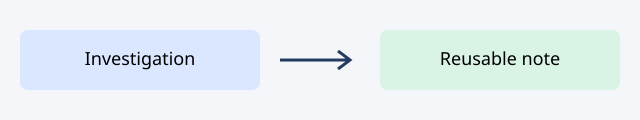

# Example: preserve a useful investigation

**Synthetic example only.** This is not company guidance or a record of executed work.

## Purpose

Demonstrate a topic guide with a local asset.

## Prerequisites

A text editor and information you are permitted to retain.

## Steps

1. Write a concise reusable procedure after an investigation.
2. Link the authoritative source and record when it was actually checked.
3. Keep ticket-specific or confidential details in their permitted location.

## Caveats, sources and last verified

No external source or verification claim; this is a format example.
